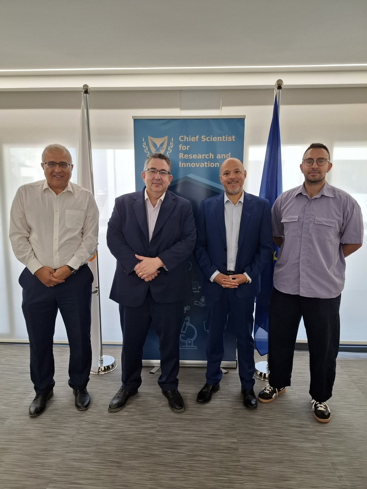

On **1 July 2026**, the #ERATOSTHENESCoE signed the grant agreement for **BIOLAND-Cy:** ***Bioarchaeology and Integrated Observation for LANdscape Dynamics in Cyprus*** with the Research and Innovation Foundation (RIF), Ίδρυμα Έρευνας και Καινοτομίας/Research and Innovation Foundation under the **EXCELLENCE HUBS programme of the RESTART 2016–2020 Research, Technological Development and Innovation Programmes**.

The agreement was signed by Mr. Theodoros Loukaidis, Director General of the Research and Innovation Foundation, and Prof. Diofantos Hadjimitsis, Director General of the ERATOSTHENES Centre of Excellence. The project is coordinated by Dr. Mahmoud Mardini from the Cultural Heritage Cluster. The signing ceremony was attended by the Chief Scientist for Research, Innovation and Technology of the Republic of Cyprus, Mr. Demetris Skourides.

**BIOLAND-Cy** is a 24 month project that, for the first time in Cyprus, will combine satellite Earth Observation with published bioarchaeological evidence to reconstruct how ancient communities lived, ate and moved across the Cypriot landscape. By integrating advanced remote sensing technologies with archaeological research, the project will provide new insights into the long term interaction between people and their environment, supporting both scientific excellence and the sustainable management of cultural heritage.

**[LinkedIn Post](https://www.linkedin.com/posts/eratosthenescoe_eratosthenescoe-biolandcy-earthobservation-activity-7478130637434929153-ok_r?utm_source=share&utm_medium=member_desktop&rcm=ACoAABbmZQcB6ER9sNDRy4NgW_avr2LC0PSVwng)**

**#BIOLANDCy #EarthObservation #Bioarchaeology #CulturalHeritage #RemoteSensing #OpenScience #Cyprus #ResearchAndInnovationFoundation #ExcellenceHubs #RESTART2016_2020 #ERATOSTHENESCoE**
